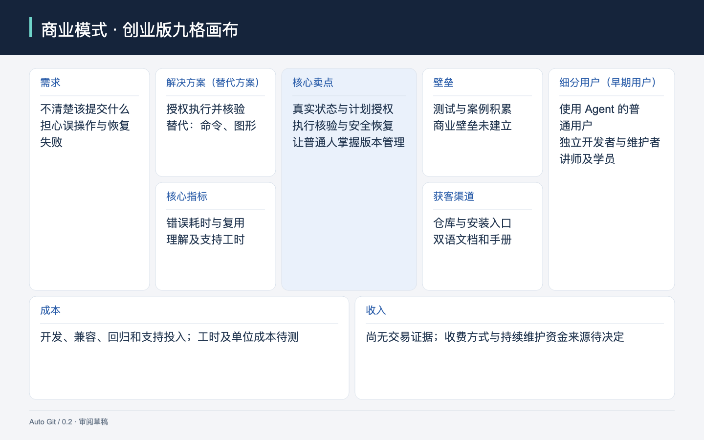
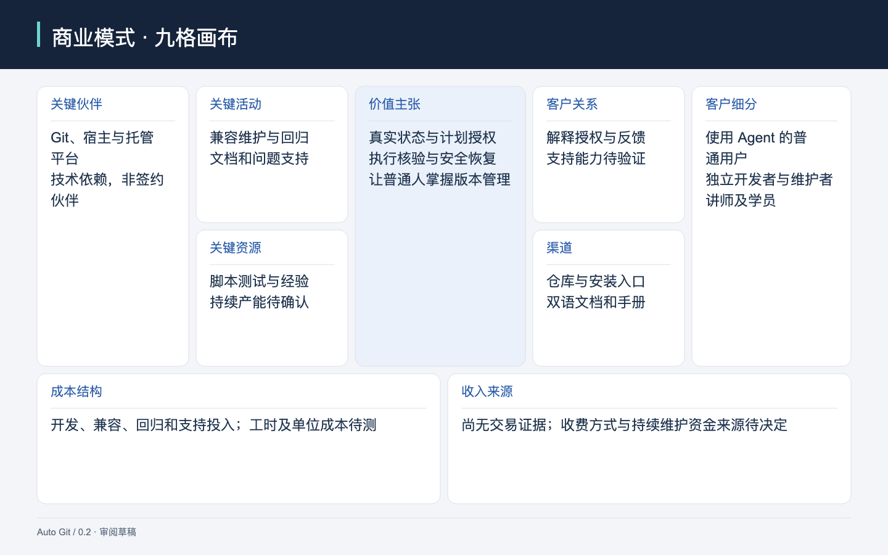
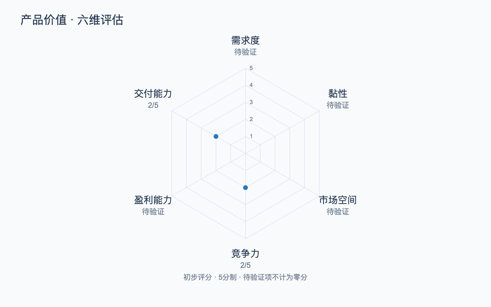

# Auto Git｜产品定义

## 1. 产品概述、使命与愿景

Auto Git 是面向使用 Agent 开发或管理项目的普通用户的独立 Agent Skill。用户用自然语言表达版本管理目标，由 Skill 解释策略、读取真实 Git 状态，并在获得相应授权后完成可验证的操作。

**使命：**让不熟悉 Git 的人也能保存、分享和恢复自己的工作，同时理解关键操作的影响。

**愿景：**版本管理成为日常创作与开发中可信赖的基础能力；用户不用记命令，也能掌握自己的文件、历史和发布边界。

产品采用标准 Git，接入既有项目不要求重写历史或更换工具链。GitHub 是当前主发行源，Gitee 同提交镜像是既定发行方向，尚待真实发布验证。

## 2. 目标用户与需求

核心用户是已经通过 Agent 完成开发或知识工作的普通人：他们希望成果可追踪、可恢复、可分享，但缺乏判断何时提交、提交哪些文件、何时推送及如何处理异常的经验。

| 用户角色 | 核心特征与需要 | 与产品的关系 |
|---|---|---|
| Git 新手、独立开发者、内容创作者 | 持续修改项目，不愿反复查命令或提醒 Agent；担心误操作 | 直接使用者与主要受益者 |
| 项目维护者、小团队负责人 | 管理多个项目，希望审批、测试和恢复规则一致 | 使用者与规则维护者；是否采购尚未验证 |
| 讲师与学员 | 需要可解释、可重复的实际 Git 操作 | 教学使用者；课程服务不属于 Skill 本身 |
| Agent 宿主 | 承载对话、技能发现和工具权限 | 执行环境，不等同于付费客户 |

**目标与场景示例：**

1. **普通用户持续开发一个项目 → 安全保存与远程备份。**从环境检查、初始化到第一次提交和推送，弄清本次保存包含什么、远程是否真的收到，以及失败时如何继续。
2. **独立开发者同时推进多项修改 → 清晰的变更组织。**按任务判断是否需要分支或 Worktree，把相关文件形成一份提交，避免混入无关改动；不强制所有任务都使用 Worktree。
3. **维护者持续迭代与发布 → 有证据的交付。**在发布前核对回归结果、版本、Tag 和远程状态，出现失败时依据记录恢复，而不是依赖 Agent 对聊天的记忆。
4. **讲师带领新手实操 → 在使用中理解 Git。**解释每个动作的用途和影响，以真实结果帮助学员建立判断能力。

以上人群来自既有产品范围，尚无独立用户访谈与分层留存数据，不能据此认定所有人群需求同样强。

深入了解：[既有用户故事与验收条件](prd/auto-git-v0.1.0.md)。

## 3. 核心价值主张

### 3.1 一句话内核

**让使用 Agent 的普通用户，通过真实状态检查、可审阅的操作计划、分级授权和结果核验，安全完成版本管理，并逐步理解自己的操作。**

### 3.2 怎样实现

1. **表达目标。**用户说“把这个阶段保存下来”或“准备发布”。Skill 先检查环境、仓库、文件改动、分支和远程，解释当前能做什么。
2. **看清动作。**确定性脚本生成与当前状态绑定的计划，说明涉及文件、预期结果、测试要求和风险。用户批准相应动作；状态变化后重新预览。
3. **执行并验证。**脚本执行精确文件操作并核对结果，反馈真实提交或远程状态。失败时保留记录、说明停止原因，并提供安全恢复路径。
4. **在操作中学习。**Skill 按需解释 Git 概念和命令，让用户能判断，而不要求先学完一门课程。

用户安装的产品只有一个 Skill，内部包含入口、契约、脚本、参考资料和测试。运行不依赖 ANK、Skill Engineering、特定模型提供商或额外 Auto Git CLI/MCP 服务；Skill Engineering 仅用于开发期治理。

安全边界是产品价值的一部分：Commit、Push、merge、Tag 和 Release 分别遵守授权；不后台监控所有目录，不代管凭证，不自动处理 merge/rebase 冲突。破坏性恢复先备份并明确确认。首次安装仍需 Git，由宿主协助准备后才能获取 Skill；当前专用远程适配优先 GitHub，其他标准 Remote 由 Git 处理。

### 3.3 满足了什么需求

- **痛点：**不知道该保存什么、能否推送，害怕丢失改动或公开不该公开的文件；出错后无法确认哪些步骤成功。
- **痒点：**希望像表达工作目标一样使用版本管理，同时保留决定权，逐步拥有维护项目的能力。
- **爽点：**看到一份清楚的文件清单和检查结果，批准后得到可核验的提交与恢复依据，知道自己的成果已被正确保存。

### 3.4 为什么值得换用

| 比较项 | 本产品的具体判断 |
|---|---|
| 原有办法与旧体验 | 手动命令、图形工具和宿主 Agent 都可以完成 Git 操作；用户仍需选择动作、组织文件并判断风险 |
| 新体验 | 将解释、状态读取、计划绑定、回归与结果验证组合为可复用流程；减少跨任务重复交代规则 |
| 替换成本 | 安装 Skill，准备 Git/Python 与宿主权限，适配项目测试；用户仍需理解并批准关键动作 |
| 值得换用的条件 | 与已有办法相比，实际减少错误、遗漏和认知负担，且新增检查和确认耗时可接受；目前缺少同任务对照证据 |

深入了解：[工程宪章](../constitution.md)、[技术架构](../engineering/architecture/auto-git.md)、[用户手册](../knowledge/users/guides/auto-git-user-manual.zh-CN.md)。

## 4. 市场与竞争分析

### 4.1 竞品类别与概览

Auto Git 面向“通过 Agent 工作时的版本管理”这一具体需求。当前比较覆盖标准 Git、两类图形入口和宿主直接执行方案；这是替代方案分析，不是完整市场调查，尚不能估算市场规模或份额。

| 类别 | 代表对象与来源 | 比较重点 |
|---|---|---|
| 命令行基础工具 | [Git](https://git-scm.com/book/en/v2/Appendix-A%3A-Git-in-Other-Environments-Graphical-Interfaces) | 可控、通用；用户需要自己组织操作与检查 |
| 独立图形入口 | [GitHub Desktop](https://docs.github.com/en/desktop/making-changes-in-a-branch/committing-and-reviewing-changes-to-your-project-in-github-desktop) | 提供变更查看与提交交互；Auto Git 是否更易用需要同任务比较 |
| 编辑器内入口 | [VS Code Source Control](https://code.visualstudio.com/docs/sourcecontrol/overview) | 在编辑器内审阅、提交和协作，降低工具切换成本 |
| 对话式替代 | 宿主 Agent 直接调用 Git | 与 Auto Git 争夺同一入口；具体安全行为依宿主、配置和版本，未做统一实测 |
| 低投入替代 | 手工复制文件夹或暂不管理版本 | 启动容易，但历史、协作和恢复依赖人的记录；为分析假设 |

### 4.2 竞争矩阵与我方位置

以下矩阵按“交互入口”和“是否额外提供专用的计划—执行—验证流程”分类，不代表质量排名。

| 交互入口 | 用户自行组织 Git 流程 | 专用流程串联检查与执行 |
|---|---|---|
| 命令或图形交互 | Git、GitHub Desktop、VS Code 基础源代码管理 | 需逐工具核验，当前不强行归类 |
| 自然语言交互 | 宿主 Agent 直接执行 Git，能力取决于配置 | Auto Git 的产品定位；需跨宿主实测证明稳定性 |

Auto Git 的机会在于让流程在不同任务中保持一致。若宿主已经可靠提供相同能力，额外安装 Skill 的理由会减弱；不能仅以“使用 AI”作为差异。

### 4.3 行业竞争：波特五力

| 力量 | 具体机制与对 Auto Git 的影响 |
|---|---|
| 现有竞争 | Git、图形客户端和编辑器已有成熟入口，必须证明新增流程的净收益 |
| 新进入者 | Skill 与脚本易复制，单靠提示词难建立持续优势 |
| 替代方案 | 宿主原生能力、项目脚本和手工操作都可满足部分需求，降低换用紧迫性 |
| 买方选择 | 用户有低成本替代，收费需建立在可观察的额外价值之上 |
| 供应方依赖 | 受宿主权限、技能发现、模型行为及远程平台影响；本地 Git 核心降低部分绑定，但无法消除兼容维护成本 |

这些是基于当前产品结构的定性推断，尚无行业集中度与用户选择数据。

### 4.4 机会、壁垒与长期发展

切入机会是已经依赖 Agent、但缺乏 Git 判断能力的人群。长期发展应围绕可验证的可靠性和低负担体验，能否形成商业规模仍未知。

| 壁垒类型 | 形成优势的具体机制 | 当前依据与成立条件 |
|---|---|---|
| 回归与失败案例 | 将真实故障积累为可复现测试，降低重复事故 | 已有自动测试；仍需持续真实用户样本 |
| 兼容经验 | 将宿主、系统、远程差异沉淀为可测试适配 | 已有设计与局部验证，跨宿主真实安装尚未全面验收 |
| 信任与教学 | 让用户理解授权并看到结果，形成再次使用习惯 | 为价值假设，缺少留存与选择证据 |
| 社区与分发 | 通过公开仓库、文档和贡献降低接入成本 | GitHub 主仓库已建立，尚无社区规模或网络效应证据 |

深入了解：[来源、比较边界与保真映射](research/2026-10-18-product-definition-review.md)。

## 5. 商业模式画布

现阶段有明确的开源产品方向，但尚未确认收费产品、价格或持续维护的资金来源。公开仓库不等于开源许可证已确定；许可证仍需单独决策。

### 创业初期版

### 传统经营版

创业版聚焦需求、替代、验证指标与优势；传统版补充持续交付所需的活动、资源、技术依赖和客户支持。两版共享客群、价值、渠道和收支判断。

[创业版 SVG](../knowledge/references/product-definition-0.2-charts/business-canvas-startup.svg) · [传统版 SVG](../knowledge/references/product-definition-0.2-charts/business-canvas-traditional.svg)

**共同经营判断：**

- **谁受益或付费：**直接受益者是普通用户与项目维护者；团队支持、培训或其他收费形式都尚未决定，不能当成已有收入。
- **怎样接触和交付：**通过标准 Skill 安装入口、GitHub 仓库、双语 README 和中文手册交付。Gitee 镜像及跨宿主安装仍需真实验证；渠道转化率未知。
- **单元模型：**建议以“每个活跃项目每月”记录持续维护负担，另记一次性接入成本。单位贡献等于该项目对应净收入减去支持、兼容维护分摊及其他直接投入；当前收入与工时数据不足，不能判断盈利。
- **模型成立条件：**使用量增加时，支持与兼容成本不能随故障无控制增长；持续维护需要明确投入来源，维护者无偿劳动也必须计入成本。
- **能否交付：**已有脚本、文档和自动回归证明本地实现基础；真实跨宿主分发、持续支持产能及付费服务能力尚未验证。

深入了解：[发行方案](../engineering/adr/0005-standard-skill-dual-remote-distribution.md)、[经营待决问题](product-questions.md#q-003)。

## 6. 产品商业价值评估

现有证据主要支持本地技术可行性，尚不足以证明需求强度、留存和商业成立。当前回归为 113 项通过、1 项可选跳过；技术测试不能替代用户结果验证。

| 维度 | 分值（5分制） | 简要说明 |
|---|---|---|
| 需求度 | 待验证 | 有具体痛点描述，缺少独立用户经历、频率与损失证据 |
| 黏性 | 待验证 | 版本管理可能反复发生，但尚无再次选择或持续使用记录 |
| 市场空间 | 待验证 | 客群明确到使用 Agent 的项目用户，未建立可服务人数与渠道口径 |
| 竞争力 | 2（初评） | 计划绑定、授权和核验有实现依据；与宿主及图形工具的净收益未经对照验证 |
| 盈利能力 | 待验证 | 收费对象、单位收入与支持成本均未确认 |
| 交付能力 | 2（初评） | 本地回归与首次 GitHub 备份有证据，跨宿主安装、长期维护仍有缺口 |

未知项不按零计分，不生成完整闭合的雷达评分面。

深入了解：[当前验证与评估依据](../project/logs/2026-10-18-daily.md)、[既有测试报告](../engineering/changes/auto-git-v0.1.0/verification.md)。

## 待解决问题

- [Q-001｜哪类用户最需要，为什么会持续使用？](product-questions.md#q-001)
- [Q-002｜相对现有工具，是否减少错误与判断负担？](product-questions.md#q-002)
- [Q-003｜谁承担持续维护投入，商业单元能否成立？](product-questions.md#q-003)
- [Q-004｜跨宿主分发和支持能否稳定交付？](product-questions.md#q-004)
- [Q-006｜许可证、镜像与后续发布边界如何确定？](product-questions.md#q-006)

**完整问题记录：**[问题与研讨记录](product-questions.md)。

**详细研究入口：**[来源与审阅记录](research/2026-10-18-product-definition-review.md)。

**研发衔接：**沿用[既有 PRD](prd/auto-git-v0.1.0.md)与[0.1.0 Spec](../engineering/specs/auto-git-v0.1.0/spec.md)。用户于2026-10-18批准本版全文；经营与价值假设仍待实证，不自动改变既有功能承诺或进入编码。
